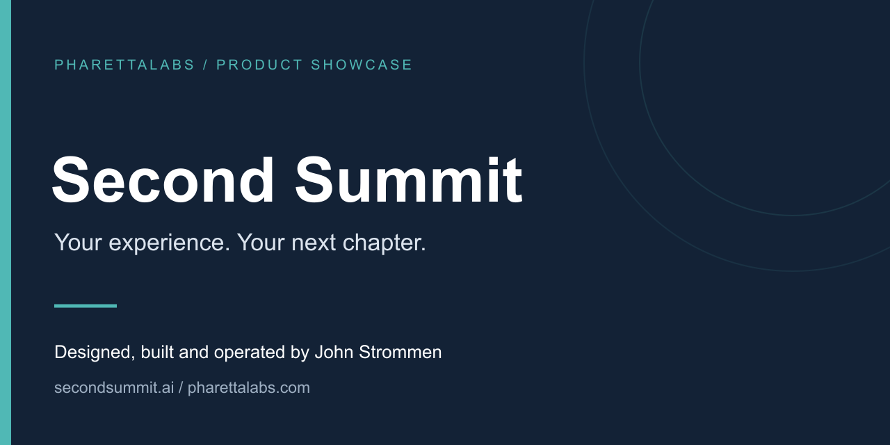
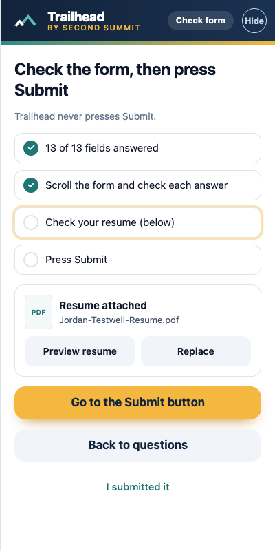
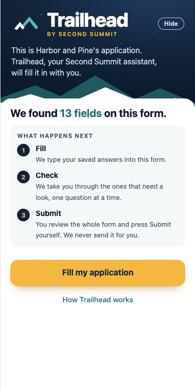

# Second Summit

A career platform built to help people find relevant opportunities, present their experience clearly, and spend less time repeating the same application work.

[Visit the app](https://secondsummit.ai) · [Watch the walkthrough](https://www.youtube.com/watch?v=mhctXPXJT9w) · [Read the case study](https://pharettalabs.com/work/second-summit/)

> Public product showcase. This repository documents an independently built PharettaLabs product; it does not contain the application's proprietary source code.

## Why I built it

A changing job market made a familiar problem harder: talented people were struggling to get noticed, while rewriting resumes for every opening was exhausting. I built Second Summit to connect job fit, application preparation, and professional identity in one experience.

## My role

I am John Strommen, founder of [PharettaLabs](https://pharettalabs.com). I led product discovery, prioritization, experience design, full-stack implementation, AI and service integrations, launch, and ongoing iteration. I use AI-assisted development tools with hands-on direction, review, and testing.

## What it does

- Resume-to-job matching with relevance scores and explanations.
- Tailored resumes and cover letters, plus application tracking.
- Professional branding through headshots, personal websites, and LinkedIn assets.
- Career guidance and conversational support.
- Trailhead application assistance: candidates review answers and submit their own applications.

## See the product

*Trailhead review states. These public product illustrations show the candidate reviewing answers and keeping control of submission. Screens may differ from the current release.*

## The hardest part

Trailhead has to work across different employer application systems while preserving candidate review. The product focuses on relevant applications and visible assistance; the user remains responsible for checking answers and submitting. Connecting several AI providers to a coherent workflow was another central product and integration challenge.

## Technology and architecture

| Technology | Role |
| --- | --- |
| Supabase | Application data and backend services |
| Netlify | Hosting and serverless delivery |
| Anthropic API | Resume-to-job scoring and AI features |
| OpenAI | Conversational voice advisor |
| Google AI | Headshot generation |
| Resend | Transactional email |

**Conceptual flow:** Candidate experience and job details → matching and guidance → candidate-reviewed documents and application assistance.

This is a high-level product overview, rather than a complete infrastructure or security specification.

## What this demonstrates

AI orchestration, matching and scoring, document workflows, browser-assisted experiences, and product design around human review.

My background in enterprise SEO, organic growth, and product leadership informs how I approach discovery, acquisition, usability, and ongoing product operation alongside the build.

## Explore the other products

- [BookWard](https://github.com/johnstrommen-jstro306/bookward-showcase) — Read. Remember. Discover.
- [Punch List](https://github.com/johnstrommen-jstro306/punch-list-showcase) — Less juggling. More getting things done.

## Have a problem worth solving?

Through [PharettaLabs](https://pharettalabs.com), I build custom apps and business tools, connect existing systems, add useful AI features, and advise on product and organic growth.

[Start a conversation in the Idea Lab](https://pharettalabs.com/start/) · [LinkedIn](https://www.linkedin.com/in/johnstrommen/) · [Email](mailto:john@pharettalabs.com)

---

Product names, brand assets, and application source remain the property of their respective owners. No open-source license is granted by this showcase.
